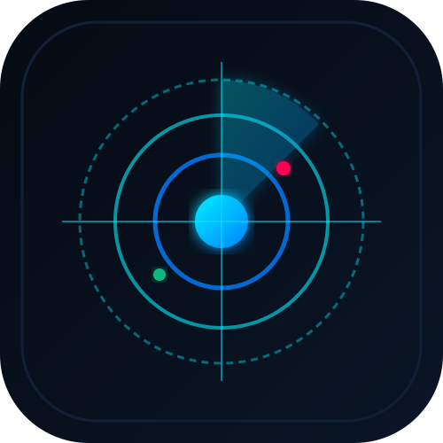

  

# Enterprise Jarvis & Jev Architecture Engine

> Architectural conflict radar, System 1 triage scanner, and historical decision memory system.

## 🚀 Features
- **Conflict Radar Scanning:** Analyzes component dependencies, triggers, and scheduled jobs to prevent circular logic and execution conflicts.
- **System 1 Triage:** Provides instant risk scoring (1–10) and domain classification before changes are deployed.
- **Memory Recall Engine:** Graph database querying previous architectural solutions, post-mortems, and design choices.

## 🛠️ Tech Stack
- Python 3.10+
- SQLite Graph Storage
- Pytest & CLI runner
