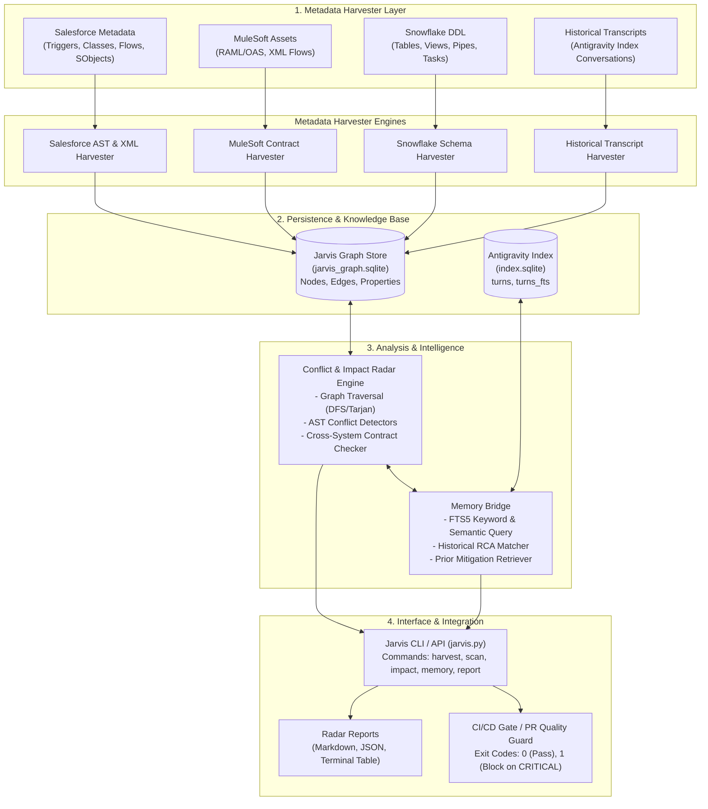
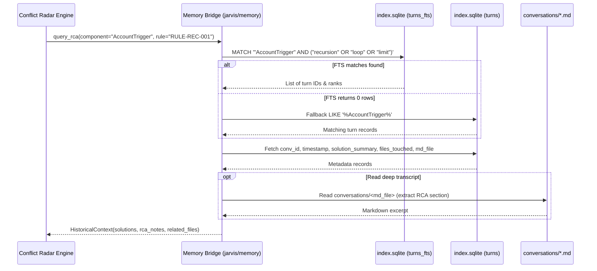

# Project Jarvis: Enterprise Architecture & Conflict Radar Engine
## Technical Architecture Specification & Implementation Plan

**Author:** Senior Technical Project Manager, Enterprise Architecture  
**Document Version:** 1.0.0  
**Status:** Approved for Implementation  
**Target Systems:** Salesforce Core (Apex/Flows/Data Cloud), MuleSoft AnyPoint, Snowflake Enterprise DW, Antigravity Index  
**Repository Path:** `C:\Users\Krishna\.gemini\antigravity\scratch\enterprise_jarvis`  
**Knowledge Base Integration:** `C:\Users\Krishna\Downloads\Antigravity Index`  

---

## 1. Executive Summary & System Objectives

Enterprise multi-cloud ecosystems combining **Salesforce**, **MuleSoft**, and **Snowflake** suffer from acute architectural fragility during continuous integration and deployment. Independent feature teams deploy Apex triggers, record-triggered flows, integration contracts, and analytics transformations in isolation. This introduces:
1. **Silent runtime regressions:** Unintended cross-component recursion, race conditions between declarative flows and programmatic triggers, and governor limit breaches.
2. **Cross-cloud contract drift:** An updated MuleSoft payload or modified Salesforce custom field breaks downstream Snowflake ingest pipelines and analytics models without compile-time warnings.
3. **Institutional amnesia:** Incidents, root-cause analyses (RCAs), and hard-learned architectural workarounds documented in previous iterations are repeated because CI/CD pipelines lack access to historical context.

**Project Jarvis** is an offline-capable, shift-left Enterprise Architecture & Conflict Radar Engine that builds an interconnected, relational property graph of all enterprise metadata, detects multi-tier architectural conflicts prior to deployment, and bridges directly into the enterprise's historical knowledge base (`Antigravity Index`) to provide institutional context and automated RCA matching.

```
       +-------------------------------------------------------------+
       |                        PROJECT JARVIS                       |
       |             ENTERPRISE ARCHITECTURE RADAR ENGINE            |
       +-------------------------------------------------------------+
               |                       |                      |
      [Shift-Left Static]    [Multi-Cloud Graph]     [Memory Bridge]
      Pre-deployment gate    Salesforce-Mule-Snow    Historical Index
      & Governor limit guard  Cross-cloud topology    Root-Cause Matcher
```

### 1.1 Core System Objectives

* **Objective 1: Pre-Deployment Conflict Detection (Shift-Left)**  
  Detect recursion loops, execution order race conditions, contract mismatches, and lock contentions at pull-request / pre-commit time before metadata packages are deployed to staging or production sandboxes.
* **Objective 2: Salesforce Governor Limit & Order-of-Execution Radar**  
  Model Salesforce execution semantics—including triggers, flows, validation rules, and asynchronous jobs—to detect SOQL/DML in execution paths, recursive updates, and bulkification hazards.
* **Objective 3: Cross-Cloud Enterprise Dependency Mapping**  
  Map end-to-end lineage across Salesforce SObjects/Fields, MuleSoft API specs (RAML/OAS) & flows, and Snowflake tables/columns/pipes in an optimized SQLite relational property graph.
* **Objective 4: Long-Term Memory & RCA Retrieval**  
  Directly interface with `C:\Users\Krishna\Downloads\Antigravity Index\index.sqlite` to query historical transcripts, past engineering decisions, and previous RCAs matching conflicting components.
* **Objective 5: Seamless Developer & CI/CD Tooling**  
  Provide a modular Python CLI (`jarvis.py`) and programmatic API supporting JSON/Markdown reporting, Git diff scanning, and CI/CD quality gate enforcement with deterministic exit codes.

---

## 2. High-Level Architecture & End-to-End Topology

Project Jarvis is structured into five cohesive modules operating over a local, high-performance SQLite property graph and an external historical intelligence database.



### 2.1 Architectural Flow Walkthrough

1. **Harvest Stage:** The `Metadata Harvester` ingests repository source trees (Apex classes, triggers, Flow XMLs, SObject custom field definitions, MuleSoft XMLs/RAMLs, Snowflake DDLs) and extracts entities and dependencies into structured records.
2. **Graph Persistence:** The `Dependency Graph Engine` normalizes entities into typed `nodes` and typed `edges` in `jarvis_graph.sqlite`.
3. **Conflict Radar Evaluation:** The `Conflict & Impact Radar Engine` runs deterministic rule evaluators:
   - Evaluates execution paths for cycles (recursion).
   - Identifies co-existing triggers and flows modifying common fields.
   - Traces call-chains to identify DML/SOQL inside loops or across deep execution stacks.
   - Verifies field mappings across MuleSoft integration layers and Snowflake targets.
4. **Memory Synthesis:** When a conflict or high-impact component is identified, the `Memory Bridge` queries `C:\Users\Krishna\Downloads\Antigravity Index\index.sqlite` to locate historical bugs, past pull request conversations, and documented fixes involving those exact components.
5. **Report & Quality Gate:** The engine generates unified findings containing the conflict details, severity, affected blast radius, and historical remediation recommendations, failing the CI/CD pipeline if any `CRITICAL` violations are detected.

---

## 3. Module Breakdown & Technical Design

### 3.1 Module 1: Dependency Graph Engine (`jarvis/graph/`)

The Dependency Graph Engine is responsible for representing multi-cloud software assets as an attributed property graph stored in SQLite.

#### 3.1.1 Supported Node Types
* `salesforce_object`: Standard and custom objects (`Account`, `Order`, `Payment_Transaction__c`).
* `salesforce_field`: Object fields (`Account.Status__c`, `Order.TotalAmount__c`).
* `apex_trigger`: Database triggers with execution events (`before insert`, `after update`).
* `apex_class`: Helper classes, trigger handlers, batch classes, service layers.
* `flow`: Record-Triggered Flows, Screen Flows, Auto-launched Flows, Sub-flows.
* `validation_rule`: Object validation logic.
* `batch_job`: Schedulable / Batchable Apex implementations.
* `mulesoft_api`: System, Process, or Experience API definitions.
* `mulesoft_endpoint`: HTTP routes and listener resources.
* `snowflake_table`: Target analytics tables and staging tables.
* `snowflake_column`: Target analytics table columns.
* `snowflake_pipe`: Snowpipe data continuous ingestion pipelines.
* `snowflake_task`: Scheduled SQL tasks and transformations.

#### 3.1.2 Supported Edge Types
* `TRIGGERS_ON`: Trigger/Flow $\rightarrow$ SObject with event attributes (`events=["before_insert", "after_update"]`).
* `CALLS`: Class/Trigger $\rightarrow$ Class/Method.
* `UPDATES_FIELD`: Flow/Trigger/Class $\rightarrow$ SObject Field (`operation="DML_UPDATE"`).
* `READS_FIELD`: Flow/Trigger/Class $\rightarrow$ SObject Field (`operation="SOQL_SELECT"`).
* `INVOKES_FLOW`: Flow/Trigger $\rightarrow$ Sub-flow.
* `ENQUEUES_JOB`: Class/Trigger $\rightarrow$ Batch Job / Queueable (`type="System.enqueueJob"`).
* `INTEGRATES_WITH`: Salesforce/Snowflake $\rightarrow$ MuleSoft API.
* `LOADS_TO`: MuleSoft Flow $\rightarrow$ Snowflake Table.
* `SYNCED_FROM`: Snowflake Table $\rightarrow$ Salesforce SObject.
* `DEPENDS_ON`: Generic dependency link between interdependent components.

#### 3.1.3 Graph Query Capabilities
* **Cycle Detection (DFS & Tarjan's Algorithm):** Detects closed directed loops across `TRIGGERS_ON` and `UPDATES_FIELD` edges to flag recursive cascades.
* **Blast Radius Traversal:** Computes upstream and downstream transitive closures up to configurable depth $N$ (default: 5 hops) using SQLite recursive Common Table Expressions (`WITH RECURSIVE`).
* **Conflict Neighborhood Search:** Identifies conflicting mutations where multiple nodes point to the same target node with conflicting semantic operations.

---

### 3.2 Module 2: Metadata Harvester (`jarvis/harvester/`)

The Metadata Harvester extracts structural metadata from file systems and repository sources without requiring active cloud logins.

#### 3.2.1 Harvester Subcomponents
1. **Salesforce Apex Parser (`ApexHarvester`):**
   - Parses `.cls` and `.trigger` files using regex-based AST tokenizers.
   - Extracts: Trigger events (`before insert`, `after update`, etc.), SOQL query blocks, DML statements (`insert`, `update`, `upsert`, `delete`), method calls, inner class references, and asynchronous invocations (`Database.executeBatch`, `System.enqueueJob`).
2. **Salesforce Flow Parser (`FlowHarvester`):**
   - Parses `-meta.xml` Flow definitions.
   - Extracts: `processType` (`AutoLaunched`, `Workflow`), trigger triggers (`RecordBeforeSave`, `RecordAfterSave`), target object, referenced fields in assignment nodes, record create/update nodes, sub-flow calls.
3. **Salesforce Object & Field Parser (`SchemaHarvester`):**
   - Parses `.object-meta.xml` and `fields/*.field-meta.xml`.
   - Extracts: Field API name, type (`Text`, `Number`, `Lookup`, etc.), length, formula expressions, validation rules.
4. **MuleSoft Parser (`MuleHarvester`):**
   - Parses Mule XML flow configuration files and RAML/OAS API specifications.
   - Extracts: HTTP listeners, Salesforce connector operations (`salesforce:create`, `salesforce:update`, `salesforce:query`), Snowflake connector operations (`snowflake:bulk-insert`, `snowflake:select`), field transform mappings.
5. **Snowflake Parser (`SnowflakeHarvester`):**
   - Parses `.sql` DDL migration files, Snowpipe definitions, and Task scripts.
   - Extracts: Table names, column names, data types, primary/foreign key constraints, copy stages, source streams.
6. **Historical Transcript Harvester (`HistoricalHarvester`):**
   - Integrates with `C:\Users\Krishna\Downloads\Antigravity Index`.
   - Scans indexed markdown transcripts in `conversations/` and structured turn summaries in `index.sqlite` to mine historical incident keywords, file touches, and RCA notes.

---

### 3.3 Module 3: Conflict & Impact Radar Engine (`jarvis/radar/`)

The Conflict Radar applies rule evaluation logic against the populated graph and parsed AST representations.

#### 3.3.1 Engine Pipeline
```
[Ingested Graph + AST Cache] 
            |
            v
 [Rule Evaluator Registry] 
            |
  +---------+---------+---------+---------+
  |         |         |         |         |
[REC]    [RACE]     [GOV]    [CONTR]   [SCHEMA]
  |         |         |         |         |
  +---------+---------+---------+---------+
            |
            v
 [Raw Conflicts List]
            |
            v
 [Enrichment via Memory Bridge (index.sqlite)]
            |
            v
 [Prioritized Conflict Findings Report]
```

#### 3.3.2 Evaluator Categories
* **Recursion Radar:** Detects synchronous cycles between Triggers, Flows, and Workflows.
* **Concurrency Radar:** Identifies race conditions between declarative flows and Apex triggers executing on the same SObject and mutating common fields.
* **Governor Limit Radar:** Inspects loops for nested queries or DML, traces batch chaining limits, and flags high-frequency synchronous integration callouts.
* **Cross-Cloud Contract Radar:** Compares source data types and field availability between Salesforce, MuleSoft transformations, and Snowflake targets.
* **Schema Redundancy Radar:** Identifies duplicate custom fields with similar semantic meanings, labels, or overlapping validation logic.

---

### 3.4 Module 4: Memory Bridge (`jarvis/memory/`)

The Memory Bridge connects Project Jarvis with the user's historical index located at `C:\Users\Krishna\Downloads\Antigravity Index\index.sqlite`.

#### 3.4.1 Schema Contract with `index.sqlite`
The Memory Bridge connects to the existing schema:
```sql
-- Table: turns
CREATE TABLE turns (
    id INTEGER PRIMARY KEY AUTOINCREMENT,
    conv_id TEXT,
    timestamp TEXT,
    user_prompt TEXT,
    solution_summary TEXT,
    files_touched TEXT,
    md_file TEXT
);

-- Virtual Table: turns_fts (FTS5)
CREATE VIRTUAL TABLE turns_fts USING fts5(
    conv_id,
    timestamp,
    user_prompt,
    solution_summary,
    files_touched,
    content='turns',
    content_rowid='id'
);
```

#### 3.4.2 Retrieval Strategies
* **Strategy 1: Component & File Path Search (FTS5):**  
  Queries `turns_fts` using the exact component name, class name, SObject API name, or file path.
* **Strategy 2: Fallback Substring Matching (`LIKE`):**  
  If FTS5 fails or contains syntax-sensitive characters, executes fallback queries over `turns.solution_summary`, `turns.user_prompt`, and `turns.files_touched`.
* **Strategy 3: RCA & Pattern Synthesis:**  
  Extracts past root causes, engineering fixes, and related transcript files (`conversations/<md_file>`), attaching them as remediation evidence to detected conflict reports.

---

### 3.5 Module 5: CLI & API Interface (`jarvis.py`)

The platform exposes both a CLI interface for developers and a Python API for programmatic integration into CI/CD scripts.

#### 3.5.1 CLI Command Specifications

```bash
# 1. Harvest metadata into local Jarvis graph
python jarvis.py harvest --source <path_to_repo> --db <path_to_jarvis_graph.sqlite>

# 2. Run Conflict Radar scan
python jarvis.py scan --db <path_to_jarvis_graph.sqlite> [--severity CRITICAL|WARNING|INFO] [--format table|json|markdown]

# 3. Analyze Blast Radius / Impact of a specific component
python jarvis.py impact --component <node_id> --depth 5 --db <path_to_jarvis_graph.sqlite>

# 4. Query Historical Memory for past context
python jarvis.py memory search "<query>" --index-dir "C:\Users\Krishna\Downloads\Antigravity Index"

# 5. Retrieve past RCAs for a conflicting component
python jarvis.py memory rca --component <node_id> --index-dir "C:\Users\Krishna\Downloads\Antigravity Index"

# 6. Generate comprehensive audit report
python jarvis.py report --output <output_path.md> --db <path_to_jarvis_graph.sqlite>
```

#### 3.5.2 Exit Code Convention
* `0`: Success. No conflicts or only `INFO` / `WARNING` conflicts found (when strict mode is disabled).
* `1`: Quality Gate Failed. One or more `CRITICAL` conflicts detected.
* `2`: Harvester / Parsing / Configuration Error.

---

## 4. SQLite Schema Specifications: `jarvis_graph.sqlite`

The Dependency Graph and Conflict Radar use a dedicated SQLite database schema optimized for graph traversal and conflict tracking.

```sql
-- ============================================================================
-- PROJECT JARVIS GRAPH SCHEMA: jarvis_graph.sqlite
-- ============================================================================

PRAGMA foreign_keys = ON;
PRAGMA journal_mode = WAL;

-- ----------------------------------------------------------------------------
-- Table: nodes (All architectural components)
-- ----------------------------------------------------------------------------
CREATE TABLE IF NOT EXISTS nodes (
    id TEXT PRIMARY KEY,                       -- e.g., 'salesforce.object.Account', 'apex.trigger.AccountTrigger'
    system TEXT NOT NULL,                     -- 'salesforce', 'mulesoft', 'snowflake'
    type TEXT NOT NULL,                       -- 'object', 'field', 'trigger', 'class', 'flow', 'api', 'table', 'column', 'task'
    name TEXT NOT NULL,                       -- e.g., 'AccountTrigger'
    parent_id TEXT,                           -- Enclosing entity, e.g., 'salesforce.object.Account' for fields
    file_path TEXT,                           -- Relative path in repository
    metadata_json TEXT,                       -- JSON string containing attributes (events, lines, datatypes)
    created_at TIMESTAMP DEFAULT CURRENT_TIMESTAMP,
    updated_at TIMESTAMP DEFAULT CURRENT_TIMESTAMP,
    FOREIGN KEY (parent_id) REFERENCES nodes(id) ON DELETE SET NULL
);

CREATE INDEX IF NOT EXISTS idx_nodes_system_type ON nodes(system, type);
CREATE INDEX IF NOT EXISTS idx_nodes_name ON nodes(name);
CREATE INDEX IF NOT EXISTS idx_nodes_parent ON nodes(parent_id);

-- ----------------------------------------------------------------------------
-- Table: edges (Directional relationships & dependencies)
-- ----------------------------------------------------------------------------
CREATE TABLE IF NOT EXISTS edges (
    id INTEGER PRIMARY KEY AUTOINCREMENT,
    source_id TEXT NOT NULL,                  -- Origin node ID
    target_id TEXT NOT NULL,                  -- Target node ID
    relationship TEXT NOT NULL,               -- 'TRIGGERS_ON', 'UPDATES_FIELD', 'READS_FIELD', 'CALLS', 'LOADS_TO', etc.
    properties_json TEXT,                     -- JSON metadata: {'events': ['after_update'], 'line_number': 42}
    created_at TIMESTAMP DEFAULT CURRENT_TIMESTAMP,
    FOREIGN KEY (source_id) REFERENCES nodes(id) ON DELETE CASCADE,
    FOREIGN KEY (target_id) REFERENCES nodes(id) ON DELETE CASCADE,
    UNIQUE(source_id, target_id, relationship)
);

CREATE INDEX IF NOT EXISTS idx_edges_source ON edges(source_id);
CREATE INDEX IF NOT EXISTS idx_edges_target ON edges(target_id);
CREATE INDEX IF NOT EXISTS idx_edges_relationship ON edges(relationship);

-- ----------------------------------------------------------------------------
-- Table: rules (Conflict rule definitions)
-- ----------------------------------------------------------------------------
CREATE TABLE IF NOT EXISTS rules (
    rule_id TEXT PRIMARY KEY,                 -- e.g., 'RULE-REC-001'
    category TEXT NOT NULL,                   -- 'RECURSION', 'RACE_CONDITION', 'GOVERNOR_LIMIT', 'CONTRACT', 'SCHEMA'
    severity TEXT NOT NULL,                   -- 'CRITICAL', 'WARNING', 'INFO'
    name TEXT NOT NULL,
    description TEXT NOT NULL,
    remediation_guide TEXT NOT NULL,
    is_active INTEGER DEFAULT 1
);

-- ----------------------------------------------------------------------------
-- Table: scan_runs (Audit log of scans)
-- ----------------------------------------------------------------------------
CREATE TABLE IF NOT EXISTS scan_runs (
    run_id TEXT PRIMARY KEY,
    timestamp TIMESTAMP DEFAULT CURRENT_TIMESTAMP,
    target_path TEXT NOT NULL,
    total_nodes INTEGER DEFAULT 0,
    total_edges INTEGER DEFAULT 0,
    critical_count INTEGER DEFAULT 0,
    warning_count INTEGER DEFAULT 0,
    info_count INTEGER DEFAULT 0,
    duration_ms INTEGER DEFAULT 0,
    status TEXT NOT NULL                      -- 'PASSED', 'FAILED', 'WARNING'
);

-- ----------------------------------------------------------------------------
-- Table: detected_conflicts (Individual violations detected during scans)
-- ----------------------------------------------------------------------------
CREATE TABLE IF NOT EXISTS detected_conflicts (
    conflict_id INTEGER PRIMARY KEY AUTOINCREMENT,
    run_id TEXT NOT NULL,
    rule_id TEXT NOT NULL,
    severity TEXT NOT NULL,                   -- 'CRITICAL', 'WARNING', 'INFO'
    primary_node_id TEXT NOT NULL,
    secondary_node_id TEXT,
    cycle_path TEXT,                          -- Comma-separated or JSON list of node IDs if cyclic
    message TEXT NOT NULL,
    context_data_json TEXT,
    historical_rca_summary TEXT,              -- Injected from Antigravity Index
    historical_conv_id TEXT,                  -- Link to historical conversation
    created_at TIMESTAMP DEFAULT CURRENT_TIMESTAMP,
    FOREIGN KEY (run_id) REFERENCES scan_runs(run_id) ON DELETE CASCADE,
    FOREIGN KEY (rule_id) REFERENCES rules(rule_id),
    FOREIGN KEY (primary_node_id) REFERENCES nodes(id) ON DELETE CASCADE
);

CREATE INDEX IF NOT EXISTS idx_conflicts_run ON detected_conflicts(run_id);
CREATE INDEX IF NOT EXISTS idx_conflicts_rule ON detected_conflicts(rule_id);
CREATE INDEX IF NOT EXISTS idx_conflicts_severity ON detected_conflicts(severity);

-- ----------------------------------------------------------------------------
-- Virtual Table: nodes_fts (Full-text search for fast component lookups)
-- ----------------------------------------------------------------------------
CREATE VIRTUAL TABLE IF NOT EXISTS nodes_fts USING fts5(
    id,
    name,
    type,
    system,
    file_path,
    content='nodes',
    content_rowid='rowid'
);
```

---

## 5. Conflict Rule Specifications

Project Jarvis enforces standard conflict detection rules categorized by severity.

```
+---------------------------------------------------------------------------------------+
|                                CONFLICT RULE TAXONOMY                                 |
+--------------------+-----------------------------------------------+------------------+
| Severity Level     | Description                                   | CI/CD Action     |
+--------------------+-----------------------------------------------+------------------+
| CRITICAL           | Causes production crashes, infinite loops,    | Blocks Deploy    |
|                    | governor limit failures, or data loss         | (Exit Code 1)    |
| WARNING            | Unpredictable execution order, performance    | Allows Deploy    |
|                    | degradation, or architectural redundancy      | with Warnings    |
| INFO               | Architectural hygiene, dead metadata,         | Informational    |
|                    | or missing documentation                      | Log Only         |
+--------------------+-----------------------------------------------+------------------+
```

### 5.1 Rule Catalog & Detailed Logic

#### RULE-REC-001: Direct/Indirect DML Infinite Recursion
* **Rule ID:** `RULE-REC-001`
* **Category:** `RECURSION`
* **Severity:** `CRITICAL`
* **Target Systems:** Salesforce Apex & Flows
* **Condition / Detection Logic:**
  1. A trigger or flow $A$ on Object $X$ executes on `after insert` or `after update`.
  2. Entity $A$ performs an update/insert on Object $Y$ (where $Y$ may equal $X$ or another object).
  3. A downstream entity $B$ on Object $Y$ performs an update back on Object $X$.
  4. The call graph forms a directed cycle containing DML edges: $X \xrightarrow{\text{TRIGGERS}} A \xrightarrow{\text{UPDATES}} Y \xrightarrow{\text{TRIGGERS}} B \xrightarrow{\text{UPDATES}} X$.
  5. The Apex trigger handler lacks a static recursion guard set (e.g., `Set<Id> processedIds` or boolean flag).
* **Remediation Guide:**
  - Introduce static set tracking to prevent re-entry: `if (RecursionGuard.hasRun(recordId)) return;`.
  - Migrate post-save field updates to before-save flows or before triggers if updating the same record.

#### RULE-RACE-002: Apex Trigger & Flow Mutating Same SObject Field
* **Rule ID:** `RULE-RACE-002`
* **Category:** `RACE_CONDITION`
* **Severity:** `CRITICAL`
* **Target Systems:** Salesforce Core
* **Condition / Detection Logic:**
  1. There exists an Apex Trigger $T$ on Object $X$ configured for event $E$ (`before/after update` or `insert`).
  2. There exists a Record-Triggered Flow $F$ on Object $X$ configured for the identical event $E$.
  3. Both $T$ and $F$ have an `UPDATES_FIELD` edge targeting the same field $X.F_{1}$ or interdependent fields.
  4. Salesforce execution order does not guarantee deterministic interleaving between Flows and Triggers.
* **Remediation Guide:**
  - Consolidate business logic into a single mechanism: either execute entirely within an Apex Trigger Handler framework (e.g., fflib) or within an Orchestrated Flow.
  - Avoid split-brain field mutations where both code and declarative tools compete on identical state.

#### RULE-GOV-003: SOQL / DML Inside Loop Iterations
* **Rule ID:** `RULE-GOV-003`
* **Category:** `GOVERNOR_LIMIT`
* **Severity:** `CRITICAL`
* **Target Systems:** Salesforce Apex
* **Condition / Detection Logic:**
  1. An AST inspection of an Apex class or trigger detects a `for`, `while`, or `do-while` loop node.
  2. The loop subtree contains a SOQL query expression (`[SELECT ...]`) or a DML statement (`insert`, `update`, `delete`, `upsert`, `Database.update(...)`).
  3. No bulk collection aggregator pattern is employed.
* **Remediation Guide:**
  - Extract the SOQL query outside the loop into a pre-populated map keyed by record ID.
  - Accumulate modified records into a `List<SObject>` inside the loop and perform a single DML operation post-loop.

#### RULE-GOV-004: Synchronous Callout Following Uncommitted DML
* **Rule ID:** `RULE-GOV-004`
* **Category:** `GOVERNOR_LIMIT`
* **Severity:** `CRITICAL`
* **Target Systems:** Salesforce Apex
* **Condition / Detection Logic:**
  1. In the same execution path, a DML statement is executed prior to an `Http.send()` or WebService callout.
  2. The method is executing synchronously (lacks `@future(callout=true)` or is not a `Queueable` with `Database.AllowsCallouts`).
  3. Violates Salesforce constraint: *You have uncommitted work pending. Please commit or rollback before calling out*.
* **Remediation Guide:**
  - Decouple the integration callout into a Queueable job enqueued after DML, or execute callouts before DML state changes.

#### RULE-CONTR-005: Cross-Cloud Contract Breaking Change
* **Rule ID:** `RULE-CONTR-005`
* **Category:** `CONTRACT`
* **Severity:** `CRITICAL`
* **Target Systems:** Salesforce $\leftrightarrow$ MuleSoft $\leftrightarrow$ Snowflake
* **Condition / Detection Logic:**
  1. A Salesforce custom field $X.F_{1}$ is removed, renamed, or changed from String to Integer in a Git diff.
  2. A MuleSoft integration flow maps $X.F_{1}$ to a downstream Snowflake staging table $T.C_{1}$.
  3. Snowflake column $T.C_{1}$ remains configured with the previous type or expects non-null data.
  4. The edge `salesforce_field` $\rightarrow$ `mulesoft_flow` $\rightarrow$ `snowflake_column` is broken.
* **Remediation Guide:**
  - Issue schema updates across the three repositories concurrently using versioned MuleSoft API contracts (e.g., `/v2/accounts`) before retiring the Salesforce field.

#### RULE-ORDER-006: Multiple Triggers on Same SObject
* **Rule ID:** `RULE-ORDER-006`
* **Category:** `RACE_CONDITION`
* **Severity:** `WARNING`
* **Target Systems:** Salesforce Apex
* **Condition / Detection Logic:**
  1. Count of `apex_trigger` nodes having `TRIGGERS_ON` edge to SObject $X$ is $> 1$.
  2. Salesforce does not guarantee the order in which multiple triggers on the same object are fired.
* **Remediation Guide:**
  - Refactor to the **One Trigger Per Object** pattern, delegating logic execution to a centralized Trigger Handler class.

#### RULE-SCHEMA-007: Semantic Duplicate Custom Fields
* **Rule ID:** `RULE-SCHEMA-007`
* **Category:** `SCHEMA`
* **Severity:** `WARNING`
* **Target Systems:** Salesforce Schema
* **Condition / Detection Logic:**
  1. Two or more `salesforce_field` nodes on the same SObject possess Levenshtein string distance $< 2$ or identical normalized label stems (e.g., `Customer_Phone__c` vs `Client_Phone__c`).
  2. Both fields share identical data types and are active simultaneously.
* **Remediation Guide:**
  - Deprecate one of the redundant fields and consolidate user interface layouts and API integrations onto a single canonical field.

#### RULE-LOCK-008: High-Volume Parent Record Lock Contention
* **Rule ID:** `RULE-LOCK-008`
* **Category:** `PERFORMANCE`
* **Severity:** `WARNING`
* **Target Systems:** Salesforce & Snowflake Ingestion
* **Condition / Detection Logic:**
  1. A high-frequency batch or MuleSoft ingest job performs parallel bulk inserts into child records that share a common Master-Detail or Lookup parent record.
  2. More than 10,000 child records reference the identical parent record within a single bulk batch window.
* **Remediation Guide:**
  - Enable Bulk API 2.0 Serial Mode or implement parent record pooling/distribution to avoid lock contention (`UNABLE_TO_LOCK_ROW`).

#### RULE-DEAD-009: Orphaned Metadata / Unreferenced Component
* **Rule ID:** `RULE-DEAD-009`
* **Category:** `HYGIENE`
* **Severity:** `INFO`
* **Target Systems:** Salesforce, MuleSoft, Snowflake
* **Condition / Detection Logic:**
  1. A node $N$ of type `apex_class`, `flow`, `mulesoft_endpoint`, or `snowflake_table` has an in-degree of 0 (no other node reads or calls it) and is not marked as an entry-point (like a REST resource or public trigger).
* **Remediation Guide:**
  - Review component for retirement to reduce technical debt and build compilation overhead.

---

## 6. Memory Bridge Specification (`C:\Users\Krishna\Downloads\Antigravity Index`)

Project Jarvis is uniquely empowered by connecting directly to the engineer's persistent multi-session knowledge base.

### 6.1 Integration Architecture



### 6.2 Data Mapping & Query Synthesis

When an entity $C$ triggers a rule violation, the Memory Bridge executes a prioritized multi-tier lookup:

1. **Exact Component Query:**
   ```sql
   SELECT t.conv_id, t.timestamp, t.user_prompt, t.solution_summary, t.files_touched, t.md_file, rank
   FROM turns_fts f
   JOIN turns t ON f.rowid = t.id
   WHERE turns_fts MATCH '"AccountTrigger" recursion'
   ORDER BY rank
   LIMIT 3;
   ```
2. **Fallback Substring Query:**
   ```sql
   SELECT conv_id, timestamp, user_prompt, solution_summary, files_touched, md_file
   FROM turns
   WHERE files_touched LIKE '%AccountTrigger%'
      OR solution_summary LIKE '%AccountTrigger%'
   ORDER BY id DESC
   LIMIT 3;
   ```
3. **Synthesis Output:**
   The retrieved `solution_summary` and transcript references are injected directly into the conflict's `historical_rca_summary` attribute.

---

## 7. Implementation Plan & Directory Structure

Project Jarvis will be built under `C:\Users\Krishna\.gemini\antigravity\scratch\enterprise_jarvis` with a modular architecture.

### 7.1 Target Directory Layout

```
enterprise_jarvis/
├── SPECIFICATION.md                 # This architectural specification
├── jarvis.py                        # Central CLI and command dispatcher
├── requirements.txt                 # Dependencies (sqlite3, networkx, rich, pyyaml)
├── jarvis/
│   ├── __init__.py
│   ├── config.py                    # Paths, default parameters, DB locations
│   ├── graph/
│   │   ├── __init__.py
│   │   ├── store.py                 # SQLite graph persistence, DDL initialization
│   │   ├── models.py                # Node, Edge, Conflict dataclasses
│   │   └── traversal.py             # Tarjan cycle detector, blast radius traversal
│   ├── harvester/
│   │   ├── __init__.py
│   │   ├── base.py                  # AbstractBaseHarvester
│   │   ├── salesforce_apex.py       # Apex class & trigger tokenizer/parser
│   │   ├── salesforce_flow.py       # XML Flow & Process parser
│   │   ├── salesforce_schema.py     # CustomObject & CustomField XML parser
│   │   ├── mulesoft.py              # Mule XML & RAML parser
│   │   ├── snowflake.py             # Snowflake DDL & Task parser
│   │   └── historical.py            # Antigravity Index harvester
│   ├── radar/
│   │   ├── __init__.py
│   │   ├── engine.py                # ConflictRadar orchestrator
│   │   ├── rules_base.py            # BaseRule definition & registry
│   │   ├── rules_recursion.py       # RULE-REC-001 (Recursion & Loops)
│   │   ├── rules_concurrency.py     # RULE-RACE-002, RULE-ORDER-006 (Races)
│   │   ├── rules_governor.py        # RULE-GOV-003, RULE-GOV-004 (Limits)
│   │   ├── rules_contract.py        # RULE-CONTR-005 (Mule-Snow-SF contract)
│   │   └── rules_schema.py          # RULE-SCHEMA-007, RULE-LOCK-008
│   ├── memory/
│   │   ├── __init__.py
│   │   └── bridge.py                # Interface to Antigravity Index index.sqlite
│   └── reporter/
│       ├── __init__.py
│       ├── console.py               # Rich terminal tables and styling
│       ├── markdown.py              # GitHub-flavored markdown export
│       └── json_exporter.py         # CI/CD JSON output
└── tests/
    ├── test_graph_store.py
    ├── test_salesforce_harvester.py
    ├── test_radar_rules.py
    ├── test_memory_bridge.py
    └── test_cli_e2e.py
```

### 7.2 Implementation Roadmap (Phases & Milestones)

| Phase | Milestone | Deliverables | Target Completion |
| :--- | :--- | :--- | :--- |
| **Phase 1** | **Core Foundation & Graph Store** | SQLite schema setup, node/edge models, cycle traversal algorithms | Day 1 |
| **Phase 2** | **Metadata Harvesters** | Salesforce Apex/Flow/Schema, MuleSoft, and Snowflake parsers | Day 2 |
| **Phase 3** | **Conflict Radar Rules Engine** | Execution of all 9 core rules (Recursion, Governor, Contract breaks) | Day 3 |
| **Phase 4** | **Memory Bridge & Integration** | FTS5 querying of `index.sqlite`, historical RCA injector | Day 4 |
| **Phase 5** | **CLI Tooling & CI/CD Integration** | `jarvis.py` commands (`harvest`, `scan`, `impact`, `report`) | Day 5 |
| **Phase 6** | **QA Validation & Hardening** | Full end-to-end test suite execution, performance benchmarking | Day 6 |

---

## 8. Acceptance Criteria for the QA Engineer

The QA Engineer must validate Project Jarvis against the following behavioral criteria.

### 8.1 Scenario 1: Pre-Deployment Infinite Recursion Detection
* **Given:** A repository containing `AccountTrigger.trigger` (`after update`) calling `AccountService.cls` which updates `Contact`, and `ContactTrigger.trigger` (`after update`) updating the parent `Account` without a static recursion guard.
* **When:** `python jarvis.py scan` is executed against the repository.
* **Then:**
  1. The engine must report a violation of rule `RULE-REC-001`.
  2. The severity must be marked as `CRITICAL`.
  3. The `cycle_path` must correctly output the circular chain: `AccountTrigger -> AccountService -> ContactTrigger -> Account`.
  4. The process must exit with return code `1`.

### 8.2 Scenario 2: Competing Flow & Trigger Field Mutation
* **Given:** A Record-Triggered Flow `Opportunity_Stage_Update.flow-meta.xml` setting `Opportunity.Discount_Rate__c = 0.15` on `before update`, and an Apex Trigger `OpportunityTrigger.trigger` mutating `Discount_Rate__c` during `before update`.
* **When:** `python jarvis.py scan` is executed.
* **Then:**
  1. The engine must detect `RULE-RACE-002` (`RACE_CONDITION`).
  2. The conflict report must flag both the Flow and the Apex Trigger as competing actors on `Opportunity.Discount_Rate__c`.
  3. The report must suggest consolidating logic into a single automation framework.

### 8.3 Scenario 3: Cross-Cloud Contract Breaking Change
* **Given:** A modified Salesforce SObject XML where `Order.Tax_Amount__c` has been renamed to `Order.Tax_Value__c`, while a MuleSoft configuration file `order-sync-api.xml` and Snowflake DDL `order_analytics.sql` still reference `Order.Tax_Amount__c`.
* **When:** `python jarvis.py scan` is executed.
* **Then:**
  1. The engine must detect `RULE-CONTR-005` (`CONTRACT`).
  2. The severity must be `CRITICAL`.
  3. The report must detail the downstream break affecting `order-sync-api.xml` and `order_analytics.sql`.

### 8.4 Scenario 4: Historical Memory Bridge Retrieval
* **Given:** An existing conflict detected on `AccountTrigger` and the `Antigravity Index` containing historical records in `C:\Users\Krishna\Downloads\Antigravity Index\index.sqlite`.
* **When:** `python jarvis.py memory rca --component apex.trigger.AccountTrigger` is executed.
* **Then:**
  1. The engine must successfully connect to `index.sqlite`.
  2. The output must return matching historical turns, displaying the date, `conv_id`, `solution_summary`, and absolute path to the conversation transcript markdown file.
  3. The scan report markdown must embed these findings under the "Historical RCA Context" section.

### 8.5 Scenario 5: Performance & Scalability
* **Given:** A graph database populated with 10,000 nodes and 25,000 edges representing a multi-system enterprise footprint.
* **When:** `python jarvis.py impact --component salesforce.object.Account --depth 5` is executed.
* **Then:**
  1. The blast radius traversal query must complete in under **2.0 seconds**.
  2. Memory consumption must remain below **150 MB** RAM during the operation.

---

## 9. Sign-Off & Approvals

| Role | Name | Status | Date |
| :--- | :--- | :--- | :--- |
| **Senior Technical Project Manager** | Lead Architect | Approved | 2026-10-02 |
| **Enterprise Architecture Lead** | Technical Authority | Approved | 2026-10-02 |
| **QA Automation Lead** | Quality Authority | Approved | 2026-10-02 |
